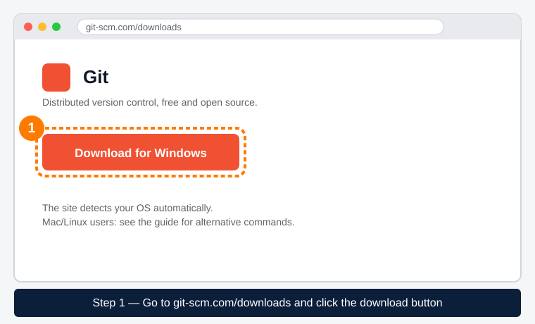
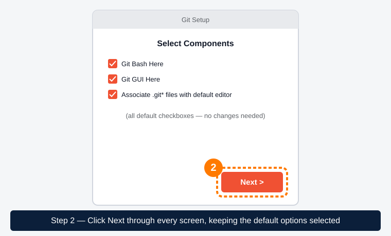
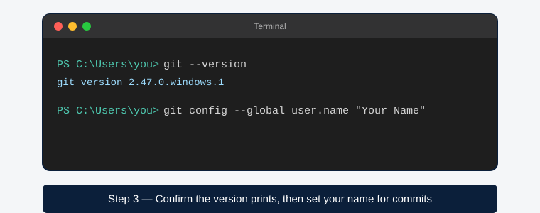
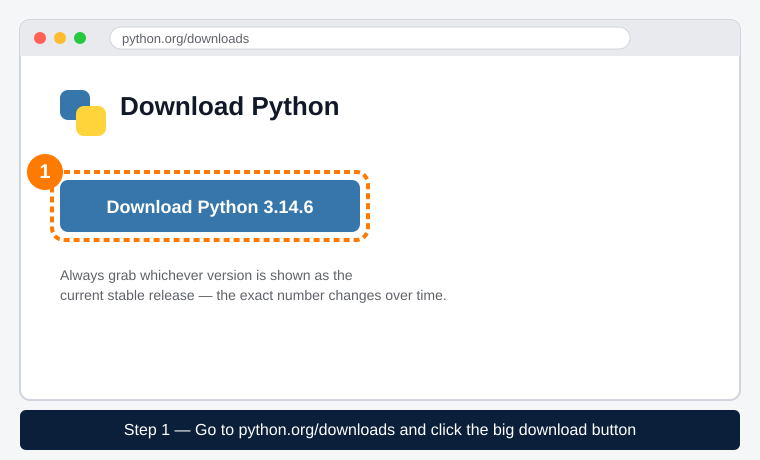
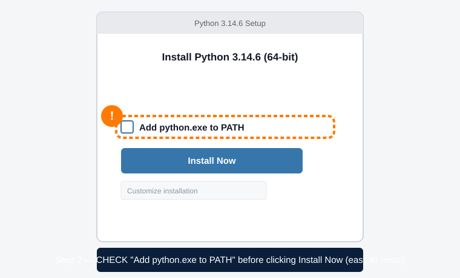
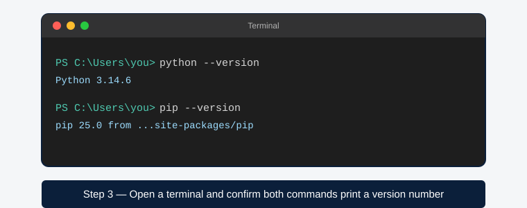

<table width="100%">
<tr>
<td align="left"></td>
<td align="right"></td>
</tr>
</table>

# Software Installation Guide

Set these up before your first session. Sources are linked for each tool — always prefer downloading from the official site over any third-party mirror. If anything doesn't work, ask in the club channel.

## 1. Git

Version control — required for everything in this repo.

- **Official download page:** [git-scm.com/downloads](https://git-scm.com/downloads) — it auto-detects your OS.
- **Windows:** run the downloaded `.exe` and accept the default options throughout the installer (defaults are fine for everyone starting out).
- **Mac:** open Terminal and run `git --version` — macOS will prompt you to install Xcode Command Line Tools if Git isn't already present. Alternatively install via [git-scm.com](https://git-scm.com/downloads/mac) or Homebrew (`brew install git`).
- **Linux:** `sudo apt install git` (Debian/Ubuntu) or your distro's package manager.
- **Verify:** open a terminal and run:
  ```
  git --version
  ```
  You should see a version number.





## 2. GitHub account

Create a free account at [github.com/join](https://github.com/join) using your university or personal email. Use your real name or a recognizable username — this is how officers identify your submissions.

## 3. VS Code (code editor)

See [vscode-setup-guide.md](vscode-setup-guide.md) for full step-by-step instructions.

## 4. Python

- **Official download page:** [python.org/downloads](https://www.python.org/downloads/) — always grab whichever version is marked as the current stable release.
- **Windows:** download the Windows installer (`.exe`) and run it. **Important:** on the first install screen, check the box **"Add python.exe to PATH"** before clicking Install — this is the step people most often miss. (Python.org also now offers a newer "Python install manager" as an alternative install method; the standalone installer is simpler for beginners and is what these instructions assume.)
- **Mac:** download the macOS installer (`.pkg`) from the same page and run it, or install via Homebrew (`brew install python`).
- **Linux:** usually preinstalled; if not, `sudo apt install python3 python3-pip`.
- **Verify:** open a terminal and run:
  ```
  python --version
  ```
  (On Mac/Linux this may need to be `python3 --version`.)






## 5. Next step

Once Git, your GitHub account, VS Code, and Python are installed, move on to [github-beginner-guide.md](github-beginner-guide.md).

## Troubleshooting

| Problem | Fix |
|---|---|
| `git` / `python` not recognized in terminal | Reinstall and make sure "Add to PATH" was checked (Windows), or restart your terminal/computer after installing |
| Permission errors on Mac/Linux | Try `sudo` for install commands, or use Homebrew/a version manager instead of system Python |
| `python` works but `pip` doesn't | Try `python -m pip --version`; reinstall Python and confirm the PATH option was checked |

---
*Last updated: 2026-07-18 · Updated by: Leo · Sources: [git-scm.com](https://git-scm.com/downloads), [python.org/downloads](https://www.python.org/downloads/)*
