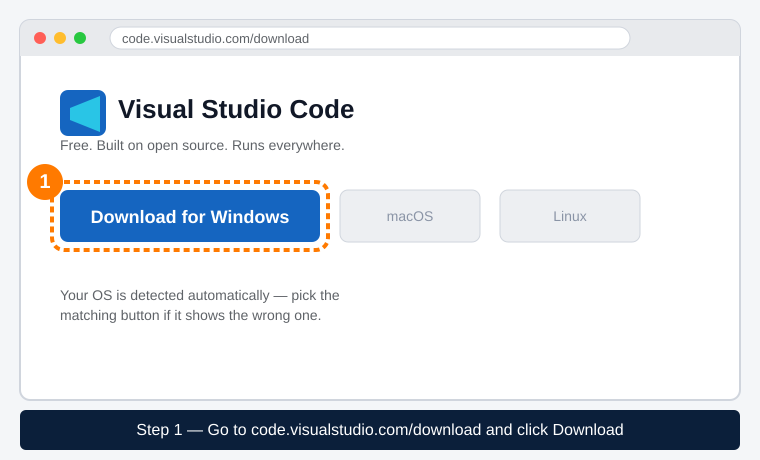
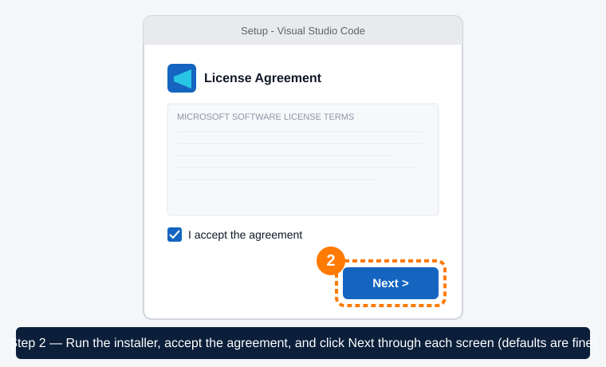
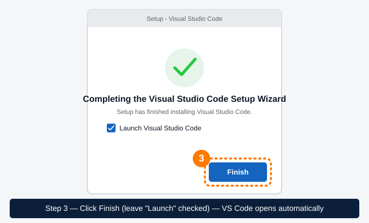
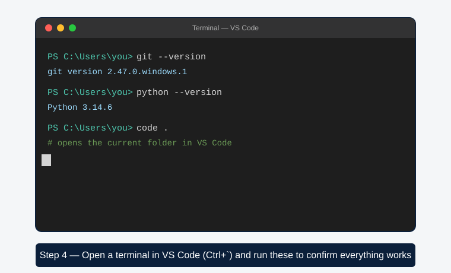

<table width="100%">
<tr>
<td align="left"></td>
<td align="right"></td>
</tr>
</table>

# VS Code Setup Guide (Step by Step)

Visual Studio Code (VS Code) is the code editor we recommend — free, lightweight, and the most widely used editor in the industry. This guide assumes zero prior experience. Official docs: [code.visualstudio.com/docs](https://code.visualstudio.com/docs).

## 1. Download

Go to **[code.visualstudio.com/download](https://code.visualstudio.com/download)** and download the installer for your OS (Windows/macOS/Linux — the site detects it automatically, but you can also pick manually).



## 2. Install

### Windows
1. Run the downloaded installer (`.exe`).
2. Follow the prompts, accepting the defaults (license agreement → Next through each screen).
3. Click Finish — VS Code launches automatically. That's it, the installer adds `code` to your PATH automatically, so you can type `code .` in any terminal to open the current folder in VS Code.




### Mac
1. Open the downloaded `.zip` — it extracts `Visual Studio Code.app`.
2. Drag it into your **Applications** folder.
3. Open it from Applications (macOS may ask you to confirm you trust it the first time — click **Open**).
4. To use `code .` from a terminal: open VS Code, press `Cmd+Shift+P`, type "Shell Command: Install 'code' command in PATH", press Enter.

### Linux (Debian/Ubuntu)
```
sudo apt update
sudo apt install ./<file>.deb
```
(replace `<file>` with the downloaded filename)

## 3. Recommended extensions

Open VS Code, click the Extensions icon in the left sidebar, search for and install:

- **Python** (by Microsoft) — Python language support
- **Jupyter** (by Microsoft) — run notebooks inside VS Code
- **GitLens** — see Git history/blame inline (optional but helpful)

VS Code also has built-in Git support (Source Control view) — you don't need a separate Git GUI, though the terminal commands in [github-beginner-guide.md](github-beginner-guide.md) work everywhere and are what we'll use in sessions.

## 4. Open this repo in VS Code

1. Clone the repo first (see [github-beginner-guide.md](github-beginner-guide.md) if you haven't).
2. In VS Code: **File → Open Folder...** → select the cloned repo folder.
3. Or from a terminal already inside the folder: `code .`

## Verify it worked

Open the built-in terminal (**Terminal → New Terminal**, or `` Ctrl+` ``) and run:
```
git --version
python --version
```
Both should print version numbers.



---
*Last updated: 2026-07-18 · Updated by: Leo · Source: [code.visualstudio.com/docs/getstarted/overview](https://code.visualstudio.com/docs/getstarted/overview)*
